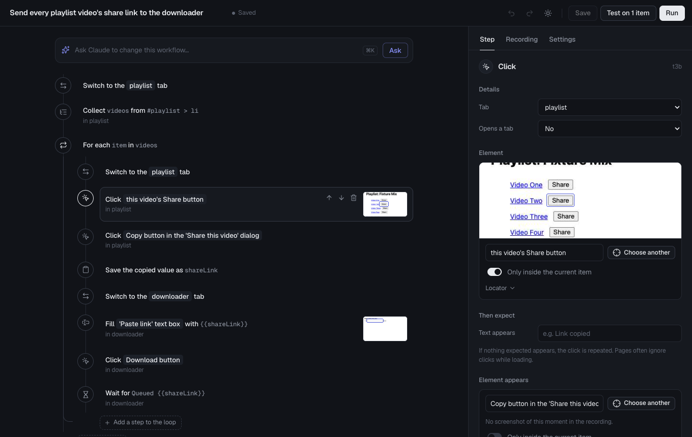
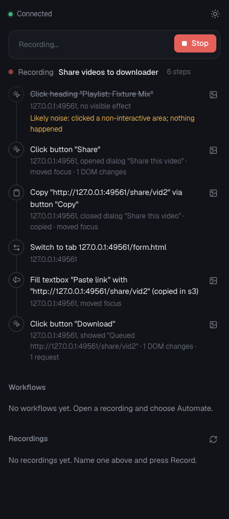
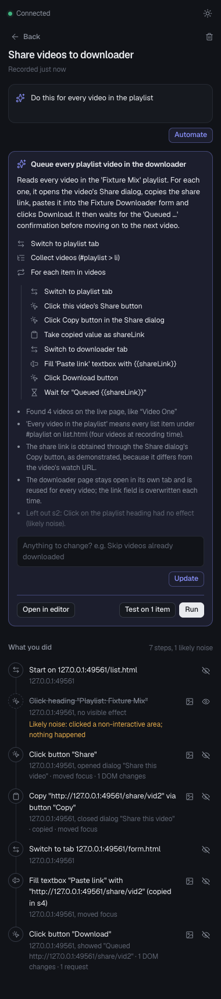
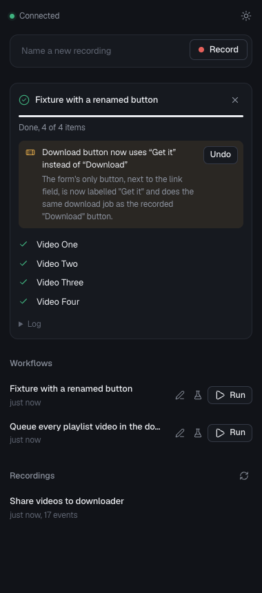
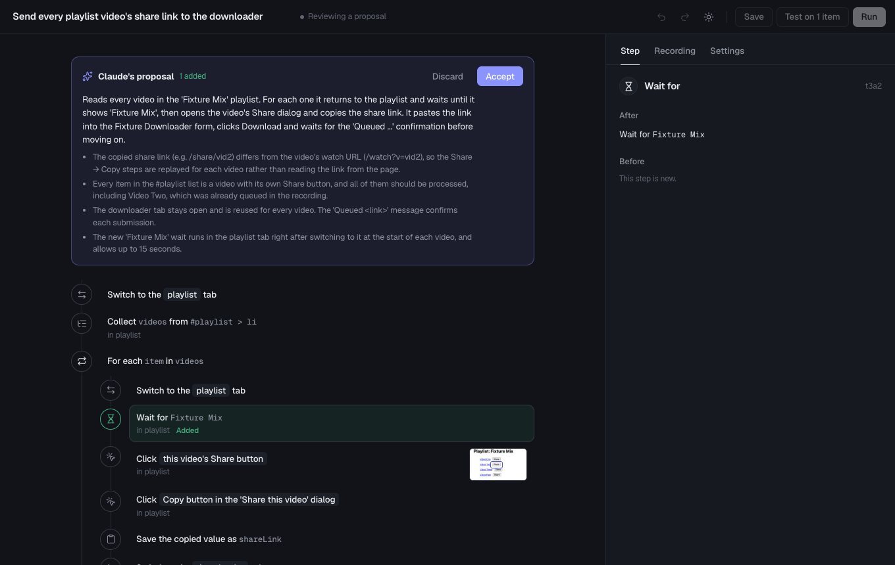
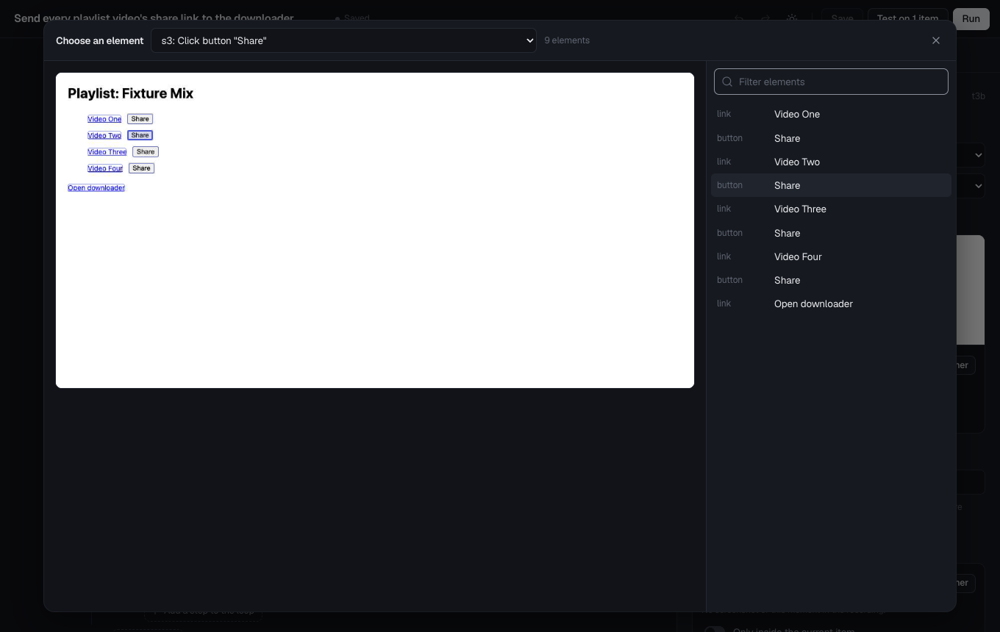
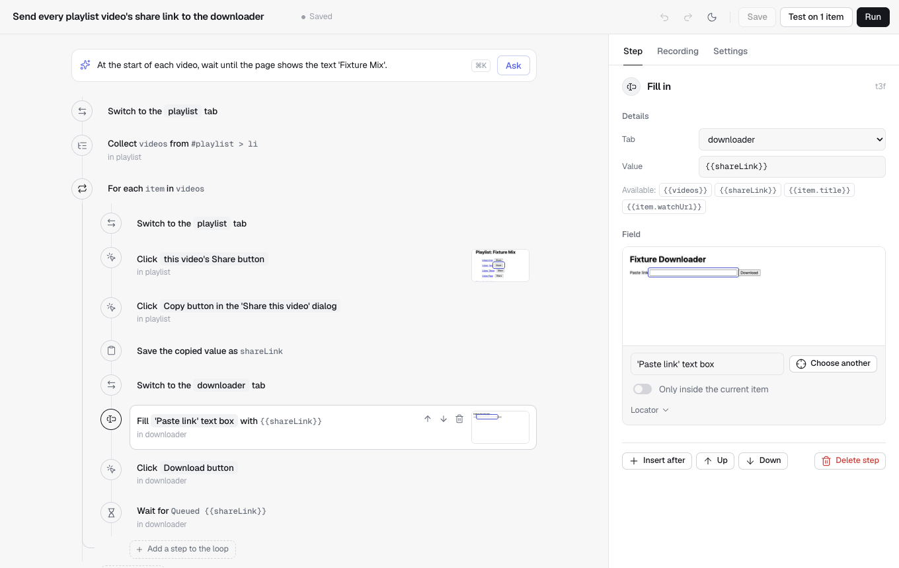

# d2a-agents

Show your browser a task once, and it does the rest.

You record yourself doing something once, like copying one video's share link into a downloader. Then you tell Claude how to generalize it ("do this for every video in the playlist"). Claude turns the recording into a workflow you can read and edit, and the extension runs it in your own browser. If a page changes under it, it asks Claude to find the moved or renamed element and keeps going.

> [!NOTE]
> **Work in progress.** This is an early prototype. It runs end to end, on test pages and on a real YouTube playlist, but expect rough edges, missing features and breaking changes. See [Status](#status) for what works and what doesn't yet.



## How it works

1. **Record.** Press Record in the side panel and use the page as you normally would. The extension records your clicks, typing and copy-paste, with a screenshot and a list of the visible elements at each step. It flags likely accidental actions as noise, such as clicks that changed nothing.
2. **Automate.** Write what should be repeated. Claude reads the recording and returns a workflow: steps, loops over lists it found on the page, and checks that each action worked. The server checks the setup against the live page and sends any problems back to Claude before you see the result.
3. **Review and edit.** Read the workflow in the side panel, or open the editor to change it directly or ask Claude for a change in plain English.
4. **Run.** Test on one item first, then run it on everything. Runs can be paused, failed items are retried and then skipped, and elements that moved are healed with Claude's help.

<table>
  <tr>
    <td width="33%"></td>
    <td width="33%"></td>
    <td width="33%"></td>
  </tr>
  <tr>
    <td>Recording. Each action appears as you go; the stray heading click is flagged as likely noise.</td>
    <td>Claude's workflow, with what it found on the live page and what it assumed.</td>
    <td>A finished run. The downloader renamed its button partway through; the run healed the step and the fix can be undone.</td>
  </tr>
</table>

## Features

**Recording**
- Records clicks, typing, key presses, copy and paste, tab switches and navigation, with a screenshot and the page's visible interactive elements at each step.
- Measures what each action did (dialogs opened, text that appeared, requests, navigation) and flags actions that did nothing as likely noise. You can override every flag.
- Doesn't record what you type into password, card-number and one-time-code fields.

**Turning a recording into a workflow**
- Claude writes the workflow from the recording plus your instruction: loops over lists, values read from the page, and checks that actions took effect.
- Targets refer back to what you actually clicked, so selectors come from the recording rather than being invented.
- The setup is checked on the live page (for example, that a list really has items). Problems go back to Claude before you see the result.
- Claude asks questions when something is ambiguous. You can answer them, or ask for changes, in the side panel.

**Editing** (the workflow editor)
- Reorder steps by dragging or with the keyboard, add steps between others, delete with undo, and edit every field.
- Choose elements on any recorded page state, by clicking them on the screenshot or picking from a list.
- Problems such as undeclared tabs or variables that aren't set yet are flagged as you type.
- Ask Claude for a change in plain English. Its proposal shows as a diff to accept or discard, and it keeps your own edits.

<table>
  <tr>
    <td width="50%"></td>
    <td width="50%"></td>
  </tr>
  <tr>
    <td>A change asked of Claude, shown as a diff before anything is saved.</td>
    <td>The element picker: every element the recording saw on that page.</td>
  </tr>
</table>

**Running**
- Runs in your real browser, with your logins, through Chrome's debugger, so pages receive real clicks and keystrokes.
- Waits for elements to appear, and repeats clicks the page ignored while it was still loading.
- Test on one item, pause, resume and stop. Failed items are retried, then skipped.
- Optionally closes ad tabs that pages open while the run is going.
- **Healing:** when a step's element can't be found, the runner asks Claude to find it among the elements now on the page. The fix is checked before it is used, and saved to the workflow only if the step then works. You can undo it.

Dark mode is the default; there is a light theme too.



## Status

Working:
- The full loop: record, automate with Claude, edit, run with healing. It is tested on the included test pages, and on a real YouTube playlist with the test downloader page.
- The side panel and the workflow editor.

Known limitations:
- **Prototype quality.** Expect bugs, and expect the stored data formats to change.
- Only Chrome (Manifest V3). Only the top frame of a page is recorded and controlled, so content inside iframes is out of reach.
- Screenshots are limited to roughly one every 600 ms, so quick actions can end up without one.
- Healing waits 15 seconds for an element before asking Claude, and doesn't yet heal the element a click waits for afterwards.
- Workflows run one at a time, in the browser you're using.
- Marking steps as noise only affects the next compile, not changes asked for in the editor.

Not yet built:
- Scheduling and running in the background, or headless.
- Learning from a second demonstration (comparing two recordings to tell fixed values from variables).
- Packaging: no Chrome Web Store build, and no setup beyond the developer steps below.

## Getting started

You need Node.js 22, [pnpm](https://pnpm.io) 11, Google Chrome, and an [Anthropic API key](https://console.anthropic.com).

```sh
pnpm install
echo "ANTHROPIC_API_KEY=sk-ant-..." > .env   # read by the server; .env is gitignored
pnpm dev:server                              # the local server, on 127.0.0.1:7821
pnpm build                                   # builds the extension into apps/extension/dist
```

Then load the extension:

1. Open `chrome://extensions` and turn on **Developer mode**.
2. Choose **Load unpacked** and select `apps/extension/dist`.
3. Click the extension's toolbar icon to open the side panel. The dot at the top turns green when it reaches the server.

### Try it on the test pages

The repo includes a small test site: a playlist page with Share → Copy buttons, and a "downloader" page with a link field.

```sh
pnpm fixtures            # serves the test pages on 127.0.0.1:7822
pnpm fixtures:workflow   # adds a ready-made workflow for them (the dev server must be running)
```

Open `http://127.0.0.1:7822/list.html` and `http://127.0.0.1:7822/form.html` in two tabs. Then either:
- run the ready-made workflow from the side panel, or
- record it yourself: press Record, share one video, paste the link into the downloader, click Download and press Stop. Then open the recording, type "Do this for every video in the playlist" and choose Automate.

## Privacy

- Everything runs on your machine. The server listens only on `127.0.0.1`. Its WebSocket accepts only the extension, and its HTTP API sends no CORS headers, so websites can't call it. Other programs on your machine can, because there is no authentication yet.
- Recordings, screenshots, workflows and runs are stored in a local SQLite file (`d2a.db`; set `D2A_DB` to put it elsewhere).
- When you automate a recording, ask for a change, or a run needs healing, the relevant steps, page elements and screenshots are sent to the Anthropic API. Page content is marked as untrusted data in those requests, and Claude's answers are limited to the workflow's format.

## Architecture

```
Chrome extension (MV3)                         Local server (Node, 127.0.0.1)
├─ content script: records actions,      ⇄ WS ├─ stores recordings, workflows, runs (SQLite)
│  finds elements, reads the page             ├─ compiler: recording + instruction → workflow (Claude)
├─ background: screenshots, tabs,             ├─ runner: interprets workflows, step by step
│  real input through chrome.debugger         └─ healer: finds moved elements (Claude)
├─ side panel: record, automate, run
└─ editor: edit workflows
```

The server drives runs: it sends small commands (click this element, fill that field, read this list) to the extension over a WebSocket, and the extension carries them out in the page.

```
apps/extension     Chrome extension: background, content script, side panel, editor
apps/server        Fastify server: store, compiler, runner, healer
packages/shared    Types and logic used by both: workflow format, event schema, step merging, checks
fixtures           The test site and ready-made workflows
e2e                Playwright tests that load the real extension
```

## Development

```sh
pnpm typecheck
pnpm test              # unit tests (Vitest)
pnpm test:e2e          # end-to-end tests: real Chromium, the built extension and an isolated server
LIVE=1 pnpm test:e2e   # also the live tests, which call Claude and visit YouTube
```

The end-to-end tests build their own copy of the extension and start their own server on port 7831 with a temporary database, so they don't touch your data. The live tests need `ANTHROPIC_API_KEY` and network access, and cost a little in API usage.
